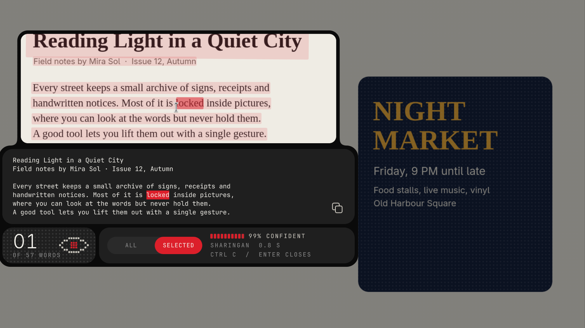
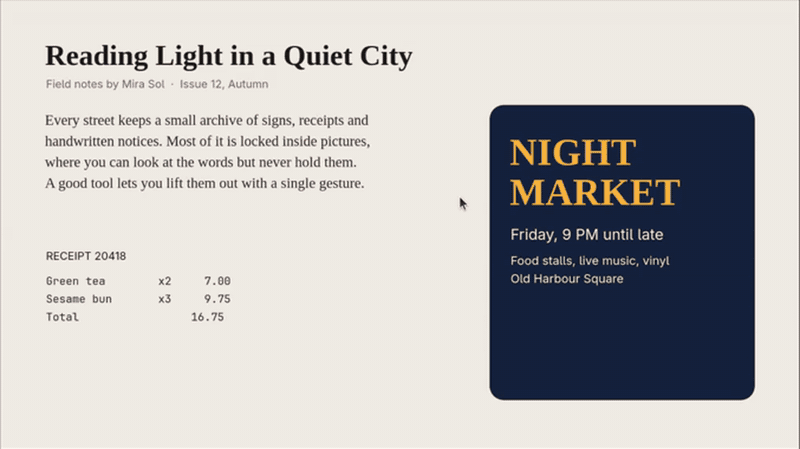
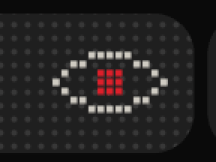
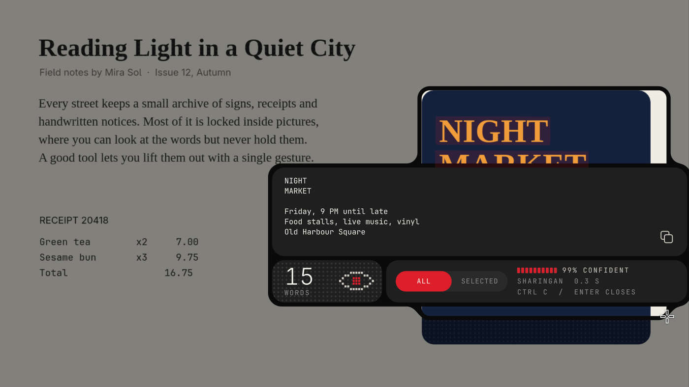

# Sharingan OCR

Freeze your screen, draw a box over anything, and select the words **right where they sit in the picture**. Sharingan reads text from screenshots, posters, videos, PDFs and images locally, with no cloud service.

[Watch the demo as a video](assets/demo.mp4)

It reads designed text too, and the panel moves inside the box when there is no room around it:

## Set it up with your AI agent

Give your coding agent this repo and say:

> Set up https://github.com/tanujarun/sharingan-ocr on this computer. Follow AGENTS.md.

The agent detects your system and either runs the installer or builds the port from the guides here. [AGENTS.md](AGENTS.md) tells it exactly what to do and how to check the result.

| System | How it gets set up | Status |
|---|---|---|
| Omarchy 4 | `install/omarchy.sh` | Daily use by the author |
| Hyprland, no Omarchy | `install/hyprland.sh` | Install and full flow tested in a nested Hyprland session |
| Sway, KDE, GNOME, X11 | Agent adapts it: [docs/linux-other.md](docs/linux-other.md) | Guide only, not yet tested |
| Windows 10 and 11 | Agent builds it: [docs/windows.md](docs/windows.md) | Guide only, not yet tested |
| macOS 13+ | Agent builds it: [docs/macos.md](docs/macos.md) | Guide only, not yet tested |

Windows and macOS are not ready-made apps. Your agent builds them from the spec, reusing the OCR engine and shaders in this repo, so expect some back and forth on the first run.

## Using it

Press **Super+Alt+C** and the screen freezes. Drag a box, and the words it finds light up.

| Action | Result |
|---|---|
| Drag across words, on the picture or in the panel | Selects them, and both stay in sync |
| Double click / triple click | Selects a word / a line |
| Ctrl+A | Selects everything |
| Ctrl+C or the copy icon | Copies and stays open |
| Right-click | Copies the line under the pointer |
| Enter | Copies and closes |
| Drag outside the box | Draws a new box |
| Esc, or click outside | Closes |

With nothing selected, copying takes all the text.

## The confidence meter

The panel shows how sure the OCR engine is about the text Copy would take, and it updates as you select, so you can check a single word. It comes from the engine's per-word scores. Across 5,438 test words on degraded text it was off by 3.4 points on average. It stops at 99%.

It has two limits. It knows nothing about text the detector never found, so a blurry image can score high while small print goes missing. And stylised display fonts can be read wrongly with high confidence.

## How it works

The screen is captured at native resolution, then [RapidOCR](https://github.com/RapidAI/RapidOCR) reads the box on the CPU, typically in 0.3 to 1.5 seconds. Tesseract is the fallback if the engine breaks, and the panel then says `TESSERACT`. The engine takes about 380 MB and runs only while the overlay is open. Frozen frames are deleted on close.

The OCR models are aimed at Chinese and English. Only English has been tested.

The example document, flyer and receipt in these images are made up.

## License

MIT. This is an independent fan-named project with no connection to the *Naruto* franchise or its rights holders.
